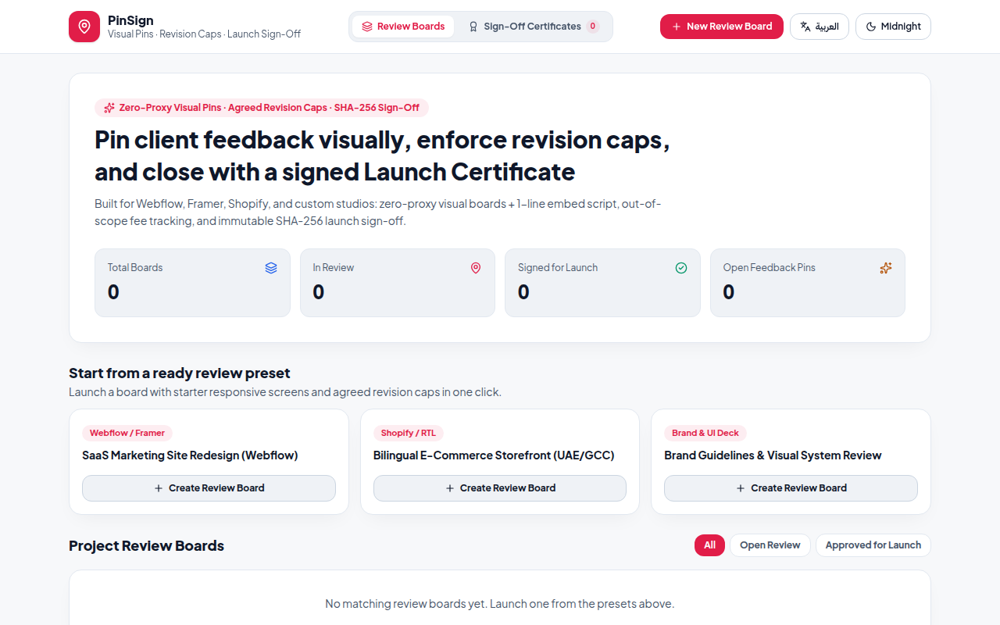
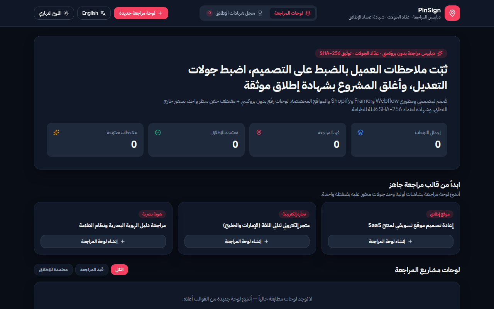
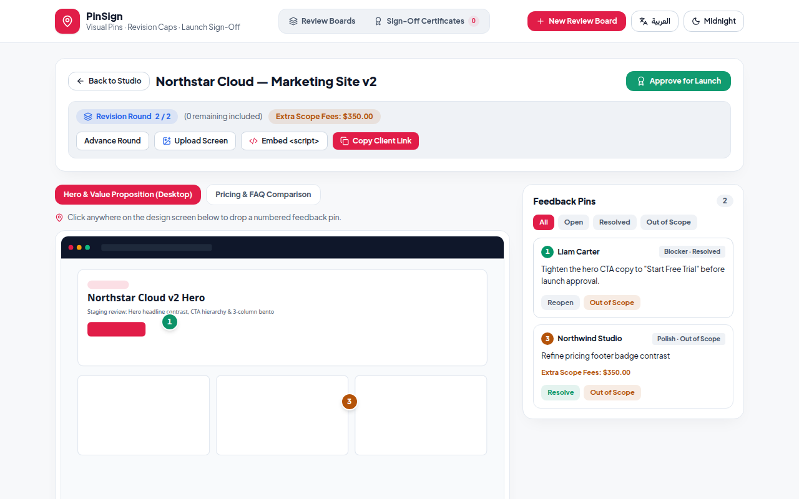
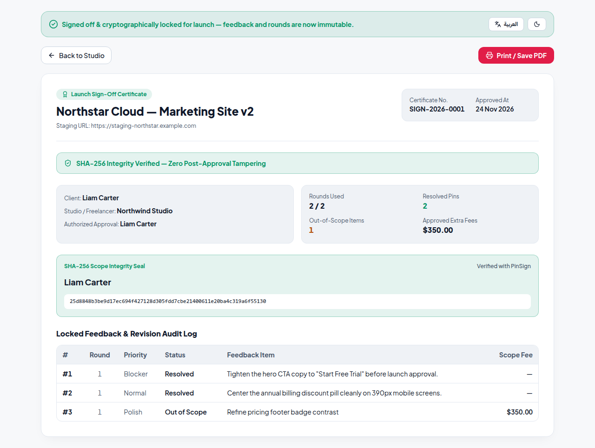
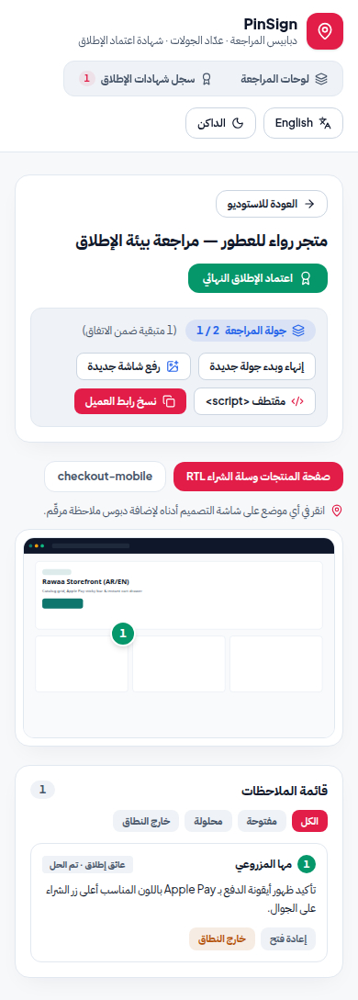
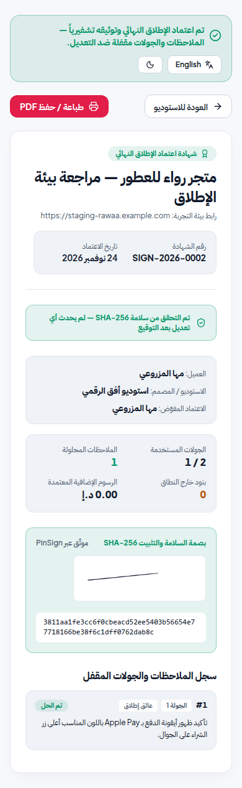

# PinSign

[](https://github.com/manea/pinsign/actions/workflows/ci.yml)
[](LICENSE)
**Zero-Proxy Visual Website & Design Pin Review, Agreed Revision Cap Tracker & SHA-256 Launch Sign-Off Certificate Portal (`EN LTR / AR RTL`).**

**أداة المراجعة والتعليق البصري المباشر بدبابيس مرقّمة على الشاشات والمواقع مع عدّاد الجولات المتفق عليها وشهادة اعتماد الإطلاق النهائية الموثّقة بصمة `SHA-256`.**

- **مستودع المصدر المفتوح (GitHub — MIT)**: [`https://github.com/manea/pinsign`](https://github.com/manea/pinsign) (`v0.5.0` + GitHub Actions CI).

PinSign replaces heavy `$79/mo` SaaS tools (MarkUp.io) and `72h`-expiring review links (Pastel) with a lightweight, self-hostable stack (**React 19, Tailwind CSS v4, Node 22 + `node:sqlite` WAL**), featuring dual themes (**Studio Slate** light & **Midnight** dark) and full bilingual **EN LTR / AR RTL** support.

---


## UI Previews (لقطات من الواجهة)

### Studio Dashboard — English LTR (`Studio Slate Light`)


### Studio Dashboard — Arabic RTL (`Midnight Dark`)


### Interactive Pin Board & Revision Rounds Tracker (Desktop)


### Immutable SHA-256 Launch Sign-Off Certificate (Desktop A4)


### Mobile Arabic RTL Pin Review Board (`390x844`)


### Mobile Arabic RTL Certificate & Drawn Signature (`390x844`)


---
## Why Zero-Proxy Architecture? (لماذا بدون بروكسي؟)

Traditional website annotation tools break behind Cloudflare challenges, CSP `frame-ancestors` headers, auth walls, and hydration scripts because they attempt to iframe-proxy third-party staging URLs. PinSign solves both use cases cleanly:

1. **Direct Screen Review Boards (PNG / JPEG / WebP uploads & starter SVG screens)**: Annotate exact `(xPct, yPct)` coordinates across desktop/mobile screens with zero iframe proxy failures.
2. **1-Line CORS `/embed.js` Widget**: Inject a Shadow DOM feedback button directly into any staging site (`Webflow`, `Framer`, `Shopify`, `Next.js`, custom staging) that posts coordinates + CSS selector hints straight back to `/api/public/boards/:slug/pins`.

---

## Core Capabilities (المزايا الأساسية)

- **Numbered Interactive Pin Annotations**: Click anywhere on a screen to drop a numbered pin (`blocker`, `normal`, or `polish`) with nested studio/client replies.
- **Agreed Revision Caps & Out-of-Scope Billing**: Track `roundsUsed / agreedRounds` transparently, flag `out_of_scope` requests with extra fee quotes (`USD`, `AED`, `SAR`), and prevent unpaid "endless revisions."
- **Blocker Sign-Off Guard**: Launch approval stays disabled whenever open/in-progress `blocker` pins remain unresolved.
- **Immutable `SHA-256` Launch Sign-Off Certificate (`/cert/SIGN-YYYY-0001`)**: Atomic sequential numbering (`SIGN-YYYY-0001`), drawn Canvas or typed client signature, permanent lock (`409` against post-approval mutations), A4 print/PDF styling, and client-side cryptographic digest verification (`verifySignOffIntegrity`).
- **Offline / Static `$0` Fallback**: When hosted on Cloudflare Workers Static Assets without the Node server, `src/lib/api.ts` falls back automatically to `localStorage` so interactive demos still work out of the box.

---

## Quickstart (التشغيل السريع محلياً)

```bash
cd projects/pinsign
npm install
npm run typecheck
npm test
npm run build
npm start
# Opens PinSign on http://127.0.0.1:4183
```

### Scripts
- `npm run dev` — Run Vite development server (`127.0.0.1:5173`, proxying `/api` to `:4183`).
- `npm run typecheck` — Run TypeScript type check (`tsc --noEmit`).
- `npm test` — Run Vitest unit & server integration suite (`tests/unit/pinsignCore.test.ts`, `tests/unit/pinsignServer.test.ts`).
- `npm run build` — Build production bundle into `dist/`.
- `npm run test:e2e` — Run Chromium Playwright E2E suite across `1280x800` desktop & `390x844` mobile (`tests/e2e/pinsign.spec.ts`).
- `npm run start:lan` — Serve production build & API on `0.0.0.0:4183`.

---

## API & Widget Reference (`server/app.mjs`)

- `GET /api/health` — Service health, version, `basePath`, and database metrics.
- `GET /api/presets` — Built-in starter presets (`saas-landing`, `shopify-store`, `brand-deck`).
- `GET|POST /api/boards` — List boards + stats, or instantiate a new board from a preset.
- `GET|PATCH|DELETE /api/boards/:id` — Read, update, or delete an unlocked review board.
- `POST /api/boards/:id/duplicate` — Clone any board (including signed/locked boards) into a fresh open board.
- `POST /api/boards/:id/screens` — Upload PNG/JPEG/WebP screen images (verified via binary Magic Bytes; max 4 MB decoded).
- `GET /api/uploads/:filename` — Serve stored screen upload images safely.
- `POST /api/boards/:id/advance-round` — Close the active round and increment `currentRound` (flagging when exceeding `agreedRounds`).
- `POST /api/boards/:id/pins` / `PATCH /api/boards/:id/pins/:pinId` / `POST /api/boards/:id/pins/:pinId/replies` — Drop pins, update status/out-of-scope fee quotes, and reply in threads.
- `GET /api/public/boards/:slug` — Public Client Review Portal endpoint (CORS `*`, increments view counter).
- `POST /api/public/boards/:slug/pins` & `POST /api/public/boards/:slug/pins/:pinId/replies` — Public client & widget pin/reply endpoints (CORS `*`).
- `POST /api/public/boards/:slug/approve` — Verify blockers/confirmation, issue atomic `SIGN-YYYY-0001`, record IP/UA SHA-256 fingerprints, and permanently lock the board.
- `GET /api/certificates` & `GET /api/certificates/:certificateNumber` — Public registry and standalone Launch Sign-Off Certificate payload.
- `GET /embed.js` — Embeddable Shadow DOM floating feedback button (`<script defer src="https://.../embed.js" data-pinsign-slug="..." data-position="bottom-right" data-locale="en"></script>`).

---

## `$0` Deployment & Sharing

See [`launch/DEPLOY-AND-SHARE.md`](launch/DEPLOY-AND-SHARE.md) for Cloudflare Workers Static Assets (`wrangler.jsonc`), Docker (`Dockerfile`, `docker-compose.yml`), `systemd` + Caddy/Tailscale (`deploy/`), SQLite + uploads backup (`deploy/backup-sqlite.sh`), and zero-budget sharing drafts.
